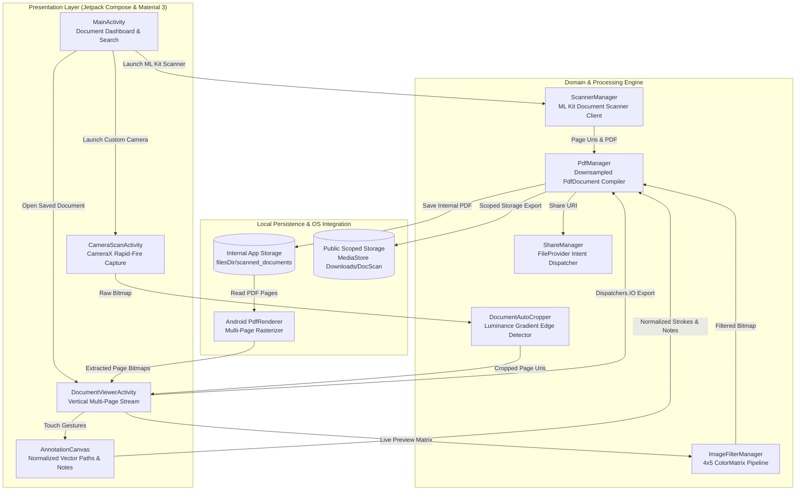

# DocScan Pro — Privacy-First Offline Android Document Scanner & PDF Suite

[](https://kotlinlang.org/)
[](https://developer.android.com/jetpack/compose)
[](https://developer.android.com/)
[](https://developer.android.com/training/camerax)
[](https://developers.google.com/ml-kit/vision/doc-scanner)
[](https://github.com/farisemad3030-sudo/DocScan-Pro/raw/main/DocScanPro.apk)
[](LICENSE)

**DocScan Pro** is a high-performance, 100% offline Android document scanning and PDF annotation application built with **Kotlin 2.0**, **Jetpack Compose (Material 3)**, **CameraX**, and **Google ML Kit**. Engineered with strict zero-network isolation (`tools:node="remove"` on `INTERNET` and `ACCESS_NETWORK_STATE`), it delivers on-device document boundary detection, perspective correction, real-time color matrix filtering, vector canvas annotations, and asynchronous multi-page PDF compilation.

---

## Key Features

- **Smart Boundary Detection & Auto-Cropping**: Combines Google ML Kit Document Scanner with a custom luminance-gradient edge detection fallback (`DocumentAutoCropper`) for real-time contour snapping and perspective deskewing.
- **Hardware-Accelerated Color Matrix Filters**: Real-time, non-destructive preview and export filters (`ImageFilterManager`) using 4x5 `ColorMatrix` transformations:
  - **Original**: Untouched sensor capture.
  - **Magic Color**: Saturation (`1.35x`) and contrast (`1.45x`) boost for crisp ink on clean white paper.
  - **High-Contrast B&W**: Desaturated threshold transformation (`2.4x` contrast) for monochrome text legibility.
  - **Clean Paper**: Shadow suppression while preserving color fidelity.
  - **Grayscale**: Pure luminance conversion.
- **Interactive Vector Annotation Suite**:
  - Multi-page vertical `LazyColumn` document viewer (`DocumentViewerActivity`).
  - Freehand **Pen** and translucent **Highlighter** (`alpha = 0.45f`) with resolution-independent normalized coordinates (`[0.0, 1.0]`).
  - Draggable **Post-It Text Notes** with real-time pointer gesture tracking and undo history.
- **Memory-Safe Asynchronous PDF Engine**:
  - Two-pass `BitmapFactory.Options` downsampling (`inJustDecodeBounds` + power-of-two `inSampleSize` capped at `1800px`) to prevent `OutOfMemoryError` on high-megapixel camera sensors.
  - Background PDF synthesis (`Dispatchers.IO`) via native `android.graphics.pdf.PdfDocument` and multi-page raster extraction via `PdfRenderer`.
  - Scoped storage export to `Downloads/DocScan` via `MediaStore` (Android 10+) and secure intent sharing via `FileProvider`.
- **Strict Offline Privacy Guarantee**: Manifest-level removal of `android.permission.INTERNET` and `android.permission.ACCESS_NETWORK_STATE` ensures zero telemetry or cloud data leakage.

---

## System Architecture



---

## Tech Stack

| Layer | Technologies & Libraries |
| :--- | :--- |
| **Language & Concurrency** | Kotlin `2.0.21`, Kotlin Coroutines (`Dispatchers.IO` / `Dispatchers.Main`) `1.9.0` |
| **UI Framework** | Jetpack Compose (`BOM 2024.12.01`), Material 3, Custom `Canvas` & Pointer Input Gestures |
| **Camera & Vision** | Google Play Services ML Kit Document Scanner `16.0.0-beta1`, AndroidX CameraX (`core`, `camera2`, `lifecycle`, `view`) `1.4.1` |
| **Image & PDF Processing** | Android `PdfDocument`, `PdfRenderer`, `ColorMatrix`, `ColorMatrixColorFilter`, Coil Compose `2.7.0` |
| **Storage & Security** | Scoped Storage (`MediaStore`), AndroidX `FileProvider`, Manifest Merger Permission Stripping |
| **Build System** | Gradle Kotlin DSL (`8.8.0` AGP), Version Catalogs (`libs.versions.toml`), Java 17 Toolchain |

---

## Project Structure

```text
doc_scanner_android/
├── app/
│   ├── build.gradle.kts
│   └── src/main/
│       ├── AndroidManifest.xml
│       ├── java/com/docscan/app/
│       │   ├── DocScanApplication.kt
│       │   ├── core/
│       │   │   ├── DocumentAutoCropper.kt   # Luminance gradient boundary detection
│       │   │   ├── ImageFilterManager.kt    # 4x5 ColorMatrix enhancement filters
│       │   │   ├── PdfManager.kt            # Downsampled PdfDocument builder & MediaStore exporter
│       │   │   ├── ScannerManager.kt        # ML Kit GmsDocumentScanner client wrapper
│       │   │   └── ShareManager.kt          # Secure FileProvider PDF sharing
│       │   ├── model/
│       │   │   ├── AnnotationModel.kt       # Normalized DrawPath, TextAnnotation & DocFilter models
│       │   │   └── ScannedDoc.kt            # Document metadata model
│       │   └── ui/
│       │       ├── AnnotationCanvas.kt      # Interactive freehand & draggable note overlay
│       │       ├── CameraScanActivity.kt    # CameraX multi-page capture screen
│       │       ├── DocumentViewerActivity.kt# Vertical viewer, filter bar & async PDF export
│       │       ├── MainActivity.kt          # Home dashboard, search & document management
│       │       └── theme/                   # Material 3 Dark/Slate color scheme & typography
│       └── res/                             # XML resources, drawables & FileProvider paths
├── gradle/
│   └── libs.versions.toml                   # Centralized dependency version catalog
├── build.gradle.kts
├── settings.gradle.kts
└── LICENSE
```

---

## Local Setup & Run Instructions

### Prerequisites
- **JDK 17** or newer
- **Android Studio Ladybug (2024.2.1+)** or **Android SDK Command-Line Tools** (`compileSdk = 35`, `minSdk = 24`)
- Physical Android device (recommended for camera & ML Kit scanning) or Android Emulator with Google Play Services

### Step-by-Step Build

1. **Clone the repository**:
   ```bash
   git clone https://github.com/farisemad3030-sudo/DocScan-Pro.git
   cd DocScan-Pro
   ```

2. **Configure Android SDK path**:
   Ensure `ANDROID_HOME` is set in your environment, or create a `local.properties` file in the root directory:
   ```properties
   sdk.dir=/path/to/your/Android/Sdk
   ```

3. **Build the debug APK via Gradle**:
   ```bash
   gradle assembleDebug
   ```

4. **Install on a connected Android device**:
   ```bash
   adb install -r app/build/outputs/apk/debug/app-debug.apk
   ```

---

## Author

**Faris Emad Al-Yamani**
- **Email**: [farisemad2019@gmail.com](mailto:farisemad2019@gmail.com)
- **LinkedIn**: [linkedin.com/in/faris-emad-2a852536a](https://www.linkedin.com/in/faris-emad-2a852536a)
- **GitHub**: [github.com/farisemad3030-sudo](https://github.com/farisemad3030-sudo)

---

## License

This project is licensed under the [MIT License](LICENSE) — Copyright (c) 2026 Faris Emad Al-Yamani.
